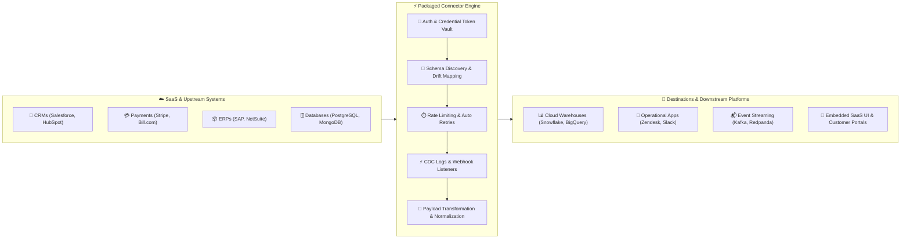
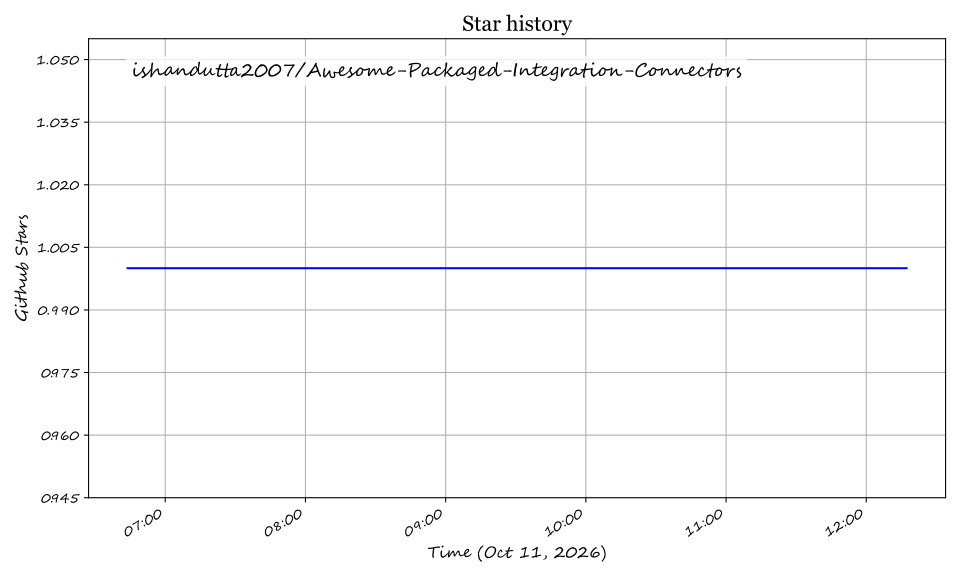

  <!-- Dynamic SVG Banner -->
  

    

  <!-- Badges Section -->
  
  
  
  
  
  

    

  

    <b>🔌 The Definitive Ecosystem Matrix for Enterprise iPaaS, Packaged SaaS Adapters, Automated ELT Connectors &amp; Open-Source Integration CDKs 🚀</b>
  

  

    <a href="#-overview--seo-guide">Overview</a> •
    <a href="#%EF%B8%8F-system-architecture-blueprint">Architecture</a> •
    <a href="#-saas--hosted-commercial-platforms">Commercial SaaS</a> •
    <a href="#-open-source-github-projects">Open-Source Engines</a> •
    <a href="#-architectural-patterns--developer-guide">Patterns</a> •
    <a href="#-how-to-contribute">Contributing</a> •
    <a href="#%EF%B8%8F-support--sponsor">Support</a> •
    <a href="#-star-history">Star History</a>
  

---

# ⚡ Awesome Packaged Integration Connectors 🔌

## 🌐 Enterprise iPaaS, Data Pipeline Connectors & Open-Source Integration Frameworks

**A Curated Engineering & Market Intelligence Guide to Packaged API Connectors, Embedded iPaaS, Cloud Data Movement, and Open-Source SDKs**  
*Comprehensive benchmarks evaluating enterprise valuation, pricing models, free tier limits, GitHub star velocity, and connector extensibility.*

📅 **Last updated: October 2026**

---

### 📖 Overview & SEO Guide

**Packaged Integration Connectors** represent the backbone of contemporary enterprise data movement, cloud integration, and workflow orchestration. Instead of engineering fragile, high-maintenance custom point-to-point scripts for every third-party service, organizations leverage standardized, pre-packaged connectors. These modular components natively abstract complex authentication handshakes (**OAuth 2.0 PKCE, API keys, mutual TLS**), handle rate-limiting backoffs and dynamic pagination, detect schema drift, and normalize transactional streams into structured representations.

This repository tracks the complete integration spectrum:
- **Enterprise Integration Platforms as a Service (iPaaS)**: Comprehensive platforms (MuleSoft Direct, Boomi, Workato, Celigo) delivering bi-directional orchestration, ESB messaging, and governed application lifecycles.
- **Modern ELT & Data Replication Pipelines**: Automated extract-and-load services (Fivetran, Airbyte, Meltano, dlt) streaming changes into cloud warehouses (Snowflake, BigQuery, Databricks).
- **Embedded iPaaS & White-Label Connectors**: Product-ready connector SDKs (Cyclr, Blendr.io, OpenFn) allowing B2B SaaS applications to ship hundreds of turnkey integrations to their end-customers.
- **Event-Driven & Workflow Automation Engines**: Extensible event hubs and node-based executors (Zapier, n8n, Activepieces, Apache Camel, Apache Kafka Connect) bridging APIs and triggering automated workflows across thousands of services.

---

## 🏗️ System Architecture Blueprint

---

## 📑 Table of Contents

- [🏢 SaaS & Hosted Commercial Platforms](#-saas--hosted-commercial-platforms)
- [💻 Open-Source GitHub Projects](#-open-source-github-projects)
  - [⚡ Workflow Automation & Event Integration](#-workflow-automation--event-integration)
  - [🔄 ELT, Data Ingestion & Stream Connectors](#-elt--data-ingestion--stream-connectors)
  - [🧩 Enterprise Integration Engines & Developer CDKs](#-enterprise-integration-engines--developer-cdks)
- [⚙️ Architectural Patterns & Developer Guide](#%EF%B8%8F-architectural-patterns--developer-guide)
- [🤝 How to Contribute](#-how-to-contribute)
- [⚠️ Disclaimer](#%EF%B8%8F-disclaimer)
- [❤️ Support & Sponsor](#%EF%B8%8F-support--sponsor)
- [⭐ Star History](#-star-history)
- [📜 License](#-license)

---

## 🏢 SaaS & Hosted Commercial Platforms

> 📊 **Market Landscape & Industry Outlook:** The global packaged integration connector and iPaaS market size is estimated at **$12.5 Billion to $15.8 Billion in 2026** (projected to reach over $35 Billion by 2032 at a CAGR of ~19.5%). The sector is **moderately fragmented**, characterized by mega-cap enterprise incumbents (Salesforce MuleSoft, Boomi, Workato) dominating complex enterprise application integration, while specialized ELT pipelines (Fivetran), visual citizen automation platforms (Zapier, Celigo), and modern embedded iPaaS/Sync platforms (Syncari, Cyclr, Parabola) aggressively capture mid-market, developer, and product-embedded integration use cases.

> *Sorted descending by company size (Valuation / Market Capitalization / Scale).*

| Platform 🏢 | Company Size & Valuation 📊 | Starting Pricing 💵 | Free Tier / Free Trial Limits 🎁 | Focus & Core Capabilities 🚀 |
| :--- | :--- | :--- | :--- | :--- |
| **[Salesforce MuleSoft Direct](https://www.mulesoft.com/platform/mulesoft-direct)** | **~$280B+** Market Cap (CRM) • **$4.2B+** Integration ARR | **$27,000/year** base enterprise tier *(Anypoint Platform capacity package)* | **30-day free trial** with full access to Anypoint Platform, CloudHub & MuleSoft Direct connectors | Turn-key enterprise integration connectors natively embedded inside Salesforce Service Cloud, Health Cloud, and Communications Cloud. |
| **[Workato Connectors](https://www.workato.com/integrations)** | **~$5.7 Billion** Valuation *(Series E)* • **~$250M+** ARR | **$10,000/year** base workspace subscription *(plus pay-per-recipe units)* | **14-day free trial** with full access to enterprise automation studio and 1,200+ pre-built connectors | Enterprise-grade iPaaS offering 1,200+ modular app connectors, community recipe templates, and secure on-premise connector agents. |
| **[Fivetran Connectors](https://www.fivetran.com/connectors)** | **~$5.6 Billion** Valuation *(Series D)* • **~$300M+** ARR | **$500/month** on Standard Plan *(volume-metered based on Monthly Active Rows)* | **Free Forever Plan**: Up to **500,000 Monthly Active Rows (MAR)** free each month; **14-day trial** with unlimited MAR | Automated ELT pipeline connectors for 600+ SaaS apps, production databases, and event streams with automatic schema drift migration. |
| **[Zapier Integrations](https://zapier.com/apps)** | **~$5.0 Billion** Valuation • **~$250M+** ARR | **$19.99/month** *(Starter plan, billed annually)* | **Free Forever Plan**: 100 tasks/month, 5 active single-step Zaps; **14-day trial** of Professional plan | Ubiquitous no-code workflow integration hub connecting 7,000+ SaaS applications, AI models, and webhooks with instant event triggers. |
| **[Boomi Connectors](https://boomi.com/platform/connectors/)** | **~$4.0 Billion** Valuation *(Acquired by Francisco Partners / TPG)* • **~$500M+** ARR | **$549/month** *(Base edition, billed annually)* | **30-day free trial** with full access to Boomi AtomSphere environment and packaged connector gallery | Cloud-native enterprise iPaaS with 300+ pre-built connectors, visual drag-and-drop mapping, and B2B/EDI transaction support. |
| **[Celigo Integrator.io](https://www.celigo.com/)** | **~$600M–$800M** Valuation • **~$100M+** ARR | **$600/month** *(Standard edition, billed annually based on endpoint count)* | **Free Forever Plan**: 1 active integration flow, unlimited run history; **30-day trial** with unlimited enterprise flows | Deep ERP and e-commerce integration platform specializing in packaged Integration Apps for NetSuite, Salesforce, Shopify, and Amazon. |
| **[Syncari Connectors](https://syncari.com/integrations/)** | **~$150M–$200M** Valuation *(Series B)* • **~$15M+** ARR | **$2,995/month** *(Growth tier, includes multi-system data governance)* | **14-day guided sandbox trial** upon consultation *(no permanent free tier)* | Multi-directional data synchronization engine and unified data model aligning CRM, marketing, and ERP records without batch collisions. |
| **[Cyclr](https://cyclr.com/)** | **~$50M–$75M** Valuation • **~$8M+** ARR | **$1,795/month** *(Growth plan, including 30 active customer integrations)* | **14-day guided proof-of-concept trial** with full white-label embedded integration studio | Embedded iPaaS built for B2B SaaS teams to package, white-label, and embed 500+ pre-built application connectors into their own products. |
| **[Parabola](https://parabola.io/)** | **~$50M–$80M** Valuation *(Series B)* • **~$10M+** ARR | **$80/month** *(Advanced plan, billed annually)* | **Free Forever Plan**: 3 active flows, 1,000 rows processed per flow run; **14-day trial** of Advanced plan | Visual drag-and-drop data pipeline builder with packaged connectors for spreadsheets, logistics systems, Shopify, and marketing APIs. |
| **[Blendr.io](https://www.qwikly.com/)** *(Acquired by Qlik)* | **Acquired by Qlik ($7.0B+ Valuation)** | **$890/month** *(Qlik Application Automation Starter tier)* | **30-day free trial** of Qlik Cloud Application Automation with complete connector catalog | Embedded customer integration marketplace and automation platform enabling software vendors to offer turnkey external integrations. |

---

## 💻 Open-Source GitHub Projects

Explore the top self-hosted open-source integration engines, data replication frameworks, and connector SDKs.

> *Sorted descending by GitHub Stars_Count.*

### ⚡ Workflow Automation & Event Integration

1. **[n8n](https://github.com/n8n-io/n8n)** —  **(206,900+ ⭐ Stars)**  
   *Fair-code workflow automation platform featuring 400+ native packaged app connectors, custom HTTP nodes, webhook triggers, and complex JavaScript/Python transforms.*

2. **[Huginn](https://github.com/huginn/huginn)** —  **(50,000+ ⭐ Stars)**  
   *Self-hosted automated agent platform built with Ruby for tracking web feeds, connecting online services, transforming JSON payloads, and dispatching actionable events.*

3. **[Apache Airflow](https://github.com/apache/airflow)** —  **(47,100+ ⭐ Stars)**  
   *Industry-standard programmatic workflow orchestration platform featuring the `apache-airflow-providers` ecosystem with 100+ packaged provider connectors for cloud services.*

4. **[Kestra](https://github.com/kestra-io/kestra)** —  **(29,400+ ⭐ Stars)**  
   *Modern event-driven and declarative orchestrator offering 500+ pre-built integration plugins and connectors defined via YAML to integrate APIs, cloud infra, and databases.*

5. **[Activepieces](https://github.com/activepieces/activepieces)** —  **(25,000+ ⭐ Stars)**  
   *Open-source no-code workflow automation engine designed as an extensible Zapier alternative with 200+ community pieces (connectors) written in clean TypeScript.*

6. **[Prefect](https://github.com/prefecthq/prefect)** —  **(24,000+ ⭐ Stars)**  
   *Python-centric workflow coordination and data automation system with modular pre-built integration blocks connecting cloud storage, APIs, and modern data warehouses.*

7. **[Argo Workflows](https://github.com/argoproj/argo-workflows)** —  **(17,000+ ⭐ Stars)**  
   *Container-native workflow engine for Kubernetes orchestrating parallel jobs and microservice connector integrations natively on cloud-native infrastructure.*

8. **[Automatisch](https://github.com/automatisch/automatisch)** —  **(14,000+ ⭐ Stars)**  
   *Self-hosted, privacy-first business automation alternative to Zapier storing all data locally without vendor lock-in, with pre-packaged connectors for popular SaaS tools.*

---

### 🔄 ELT, Data Ingestion & Stream Connectors

1. **[Apache Kafka](https://github.com/apache/kafka)** —  **(33,900+ ⭐ Stars)**  
   *Distributed event streaming platform providing the Kafka Connect framework for horizontally scalable streaming connectors linking databases, key-value stores, and file sinks.*

2. **[Airbyte](https://github.com/airbytehq/airbyte)** —  **(22,200+ ⭐ Stars)**  
   *The leading open-source data integration platform featuring 350+ pre-built ELT source and destination connectors managed via declarative specifications and Docker containers.*

3. **[Redpanda](https://github.com/redpanda-data/redpanda)** —  **(12,600+ ⭐ Stars)**  
   *High-performance, C++ Kafka-compatible streaming data engine supporting Redpanda Connect (formerly Benthos) with 200+ pre-packaged streaming connectors and processors.*

4. **[CloudQuery](https://github.com/cloudquery/cloudquery)** —  **(6,500+ ⭐ Stars)**  
   *High-throughput open-source ELT framework extracting configurations, logs, and state from hundreds of cloud APIs, identity providers, and SaaS apps into SQL engines.*

5. **[dlt (data load tool)](https://github.com/dlt-hub/dlt)** —  **(6,000+ ⭐ Stars)**  
   *Python-first lightweight data loading library that turns messy API responses into normalized database tables with automatic schema inference and packaged verified sources.*

6. **[Inngest](https://github.com/inngest/inngest)** —  **(5,900+ ⭐ Stars)**  
   *Event-driven serverless background orchestration engine that enables writing durable functions with step-level retries and pre-integrated webhooks across third-party services.*

7. **[RudderStack (Rudder-Server)](https://github.com/rudderlabs/rudder-server)** —  **(4,500+ ⭐ Stars)**  
   *Customer data platform (CDP) core engine processing event streams with 150+ pre-built integration connectors routing customer behavioral events to marketing and analytics tools.*

8. **[Meltano](https://github.com/meltano/meltano)** —  **(2,700+ ⭐ Stars)**  
   *CLI-driven, GitOps-ready data integration hub for managing modular Singer Taps (extractors) and Targets (loaders) as version-controlled code artifacts.*

9. **[Singer Getting Started](https://github.com/singer-io/getting-started)** —  **(1,400+ ⭐ Stars)**  
   *The open-source specification for composable, Unix-pipe data extraction scripts (Taps) and loading destinations (Targets) using standardized JSON stream protocols.*

---

### 🧩 Enterprise Integration Engines & Developer CDKs

1. **[Apache Camel](https://github.com/apache/camel)** —  **(6,400+ ⭐ Stars)**  
   *The definitive enterprise integration patterns (EIP) implementation providing 300+ battle-tested packaged component connectors covering cloud APIs, IoT, Kafka, and enterprise protocols.*

2. **[Airbyte Connector Development Kit (CDK)](https://github.com/airbytehq/airbyte/tree/master/airbyte-cdk)** —  **(22,200+ ⭐ Stars)**  
   *Declarative YAML and Python framework for creating custom packaged connectors in minutes, handling pagination, token refresh, and stream slicing automatically.*

3. **[OpenFn Lightning](https://github.com/openfn/lightning)** —  **(300+ ⭐ Stars)**  
   *Digital public good and open-source workflow automation platform for public health and NGO operations, featuring 80+ pre-built adaptable connectors.*

---

## ⚙️ Architectural Patterns & Developer Guide

When architecting production integration systems, connector implementations generally follow three primary integration paradigms:

1. **Batch & Incremental ELT (Extract, Load, Transform)**:
   - **Mechanism**: Scheduled extraction querying REST endpoints with cursor-based pagination and state bookmarks (`updated_at >= :last_checkpoint`).
   - **Key Considerations**: Endpoint rate-limit governance, dynamic backoff algorithms, checkpoint persistence, and automatic schema drift evolution.
   - **Recommended Stack**: Airbyte, Fivetran, Meltano, dlt.

2. **Real-Time Event-Driven & Webhook Streaming**:
   - **Mechanism**: Event-triggered ingestion listening to HTTP webhooks or message queues (Kafka, AMQP) with instant downstream fan-out.
   - **Key Considerations**: Signature validation (HMAC-SHA256), idempotency tracking, dead-letter queues (DLQ), and sub-second execution.
   - **Recommended Stack**: n8n, Activepieces, Apache Kafka Connect, Kestra.

3. **Embedded iPaaS & Multi-Directional Sync**:
   - **Mechanism**: Two-way synchronization aligning entities (Contacts, Invoices, Leads) across disparate CRMs and ERPs with conflict resolution rules.
   - **Key Considerations**: Record deduplication, bidirectional state reconciliation, embeddable white-label OAuth flows, and tenant isolation.
   - **Recommended Stack**: Syncari, Cyclr, Celigo, Airbyte CDK.

---

## 🤝 How to Contribute

We welcome community contributions, new connector additions, and updates!

1. 🍴 **Fork** this repository.
2. 📝 **Add or update** entries in `README.md` maintaining the exact structure (ensure verified pricing, Stars_Counts, and direct links).
3. 🧪 Verify all markdown links, table alignments, and badge formatting.
4. 🚀 Submit a **Pull Request** with a concise summary of changes.

---

## ⚠️ Disclaimer

- This curated directory is maintained for informational and developer reference purposes. Trademarks and product names belong to their respective corporate owners.
- SaaS platform pricing and free tier limits reflect published rates as of October 2026 and are subject to vendor updates.

---

## ❤️ Support & Sponsor

Thank you for visiting and supporting the **Awesome Packaged Integration Connectors** project!

If you find this repository helpful for your engineering research, integration architecture, or development workflows:
- ⭐ **Star** this repository on GitHub to help others find it.
- 🍴 **Fork** it to keep a personal curated reference or contribute upstream.
- 📢 **Share** it with your software engineering peers and integration teams.
- ☕ **Buy me a coffee / Sponsor**: Support the maintenance and continuous curation of open-source developer resources via the [GitHub Sponsors Dashboard](https://github.com/sponsors/ishandutta2007).

---

## 📈 Star History

---

## 📜 License

This repository is licensed under the [MIT License](LICENSE).

## Star History

<a href="https://star-history.com/#ishandutta2007/Awesome-Packaged-Integration-Connectors&Timeline" align="center">
  <picture>
    <source media="(prefers-color-scheme: dark)" srcset="assets/ishandutta2007_Awesome-Packaged-Integration-Connectors_growth.svg">
    
  </picture>
</a>
