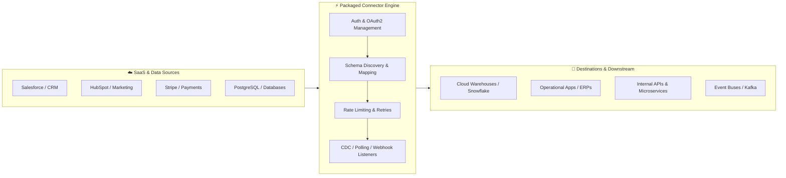

# Awesome-Packaged-Integration-Connectors 🔌

  
  
  
  
  
  
  

 

> A curated list of awesome **Packaged Integration Connectors**, pre-built SaaS adapters, embedded iPaaS, ELT data extractors, and open-source connector ecosystems.

---

## 📌 Overview & Architecture Blueprint

**Packaged Integration Connectors** provide pre-built, standardized adapters and pipelines connecting disparate SaaS applications, enterprise databases, cloud data warehouses, and custom APIs. Instead of building and maintaining custom point-to-point API integrations, packaged connectors handle authentication flows (OAuth2, API keys), rate limiting, pagination, schema evolution, and real-time event streaming out of the box.

---

## 📑 Table of Contents

- [🏢 SaaS & Hosted Commercial Platforms](#-saas--hosted-commercial-platforms)
- [💻 Open-Source GitHub Projects](#-open-source-github-projects)
  - [🔄 ELT & Data Replication Connectors](#-elt--data-replication-connectors)
  - [⚡ Workflow Automation & Event Connectors](#-workflow-automation--event-connectors)
  - [🧩 Embedded iPaaS & Developer Connector SDKs](#-embedded-ipaas--developer-connector-sdks)
- [🤝 How to Contribute](#-how-to-contribute)
- [📈 Star History](#-star-history)
- [📜 License](#-license)

---

## 🏢 SaaS & Hosted Commercial Platforms

> 📊 **Market Landscape & Industry Outlook:** The global packaged integration connector and iPaaS market size is estimated at **$12.5 Billion to $15.8 Billion in 2026** (projected to reach over $35 Billion by 2032 at a CAGR of ~19.5%). The sector is **moderately fragmented**, characterized by mega-cap enterprise incumbents (Salesforce MuleSoft, Boomi, Workato) dominating complex enterprise application integration, while specialized ELT pipelines (Fivetran), visual citizen automation platforms (Zapier, Celigo), and modern embedded iPaaS/Sync platforms (Syncari, Cyclr, Parabola) aggressively capture mid-market, developer, and product-embedded integration use cases.

> *Sorted descending by company size (Valuation / Market Capitalization / Scale).*

| Platform | Company Size & Valuation | Focus & Core Capabilities | Starting Pricing | Free Tier / Free Trial Limits |
| :--- | :--- | :--- | :--- | :--- |
| **[Salesforce MuleSoft Direct](https://www.mulesoft.com/platform/mulesoft-direct)** | **~$280B+** Market Cap (CRM) • **$4.2B+** Integration Segment ARR | Packaged turn-key connectors and pre-built integration apps linking core Salesforce clouds directly to external ERPs, billing, and customer platforms. | Starts at **~$27,000/year** (custom enterprise subscription based on core capacities) | **30-day free trial** of Anypoint Platform with full connector evaluation access. |
| **[Boomi Connectors](https://boomi.com/platform/connectors/)** | **~$4.0 Billion** Valuation *(Acquired by Francisco Partners / TPG)* • **~$500M+** ARR | Cloud-native iPaaS with a library of 300+ pre-packaged enterprise connectors, automated data mapping, and EDI trading partner integrations. | Starts at **$549/month** (Base edition, billed annually) | **30-day free trial** with access to Boomi Atmosphere and pre-built connectors. |
| **[Workato Connectors](https://www.workato.com/integrations)** | **~$5.7 Billion** Valuation *(Series E)* • **~$250M+** ARR | Enterprise integration and automation platform featuring 1,200+ pre-built connectors, Enterprise Automation recipes, and secure on-premises agent connectivity. | Custom enterprise pricing starting at **~$10,000/year** (base workspace plus recipe units) | **14-day free trial** of Workato platform and community connector recipe library. |
| **[Fivetran Connectors](https://www.fivetran.com/connectors)** | **~$5.6 Billion** Valuation *(Series D)* • **~$300M+** ARR | Fully managed, automated ELT connectors for 600+ SaaS applications, databases, and event streams into cloud data warehouses with schema drift handling. | Free tier available; Paid usage starts at **~$500/month** (based on Monthly Active Rows / MAR) | **Free Forever Plan** includes up to **500,000 MAR/month**; 14-day unlimited free trial for all connectors. |
| **[Zapier Integrations](https://zapier.com/apps)** | **~$5.0 Billion** Valuation • **~$250M+** ARR | The ubiquitous no-code integration platform connecting 7,000+ commercial apps, webhooks, and AI assistants with automated trigger-and-action connector logic. | Free tier available; Paid plans start at **$19.99/month** *(Starter tier, billed annually)* | **Free Forever Plan** with 100 tasks/month and 5 active single-step Zaps; 14-day trial of Professional tier. |
| **[Celigo Integrator.io](https://www.celigo.com/)** | **~$600M–$800M** Valuation • **~$100M+** ARR | Complete iPaaS featuring pre-built Integration Apps and packaged smart connectors for NetSuite, Salesforce, Shopify, Amazon, and ERP ecosystems. | Custom pricing starting at **~$600/month** (Standard edition based on endpoint connections) | **Free Forever Plan** includes 1 free active integration flow; 30-day unlimited trial of Integrator.io. |
| **[Syncari Connectors](https://syncari.com/integrations/)** | **~$150M–$200M** Valuation *(Series B)* • **~$15M+** ARR | Multi-directional sync engine and unified data model connectors designed to align, deduplicate, and govern customer data across CRM, marketing, and finance stacks. | Starts at **$2,995/month** *(Growth tier for unified RevOps data synchronization)* | **14-day guided proof-of-concept trial** upon sales consultation. |
| **[Cyclr](https://cyclr.com/)** | **~$50M–$75M** Valuation • **~$8M+** ARR | Embedded iPaaS purpose-built for SaaS vendors to package, white-label, and embed 500+ pre-built application connectors directly into their own software products. | Starts at **$1,795/month** (Growth plan including 30 active client integrations) | **14-day guided trial** with full white-label connector studio access. |
| **[Parabola](https://parabola.io/)** | **~$50M–$80M** Valuation *(Series B)* • **~$10M+** ARR | Collaborative data automation platform with pre-packaged connectors for e-commerce, logistics, and spreadsheet workflows with drag-and-drop transformations. | Free tier available; Paid plans start at **$80/month** *(Advanced tier)* | **Free Forever Plan** includes up to 3 flows and 1,000 rows processed per run; 14-day trial of paid tiers. |
| **[Blendr.io](https://www.qwikly.com/)** *(Acquired by Qlik)* | **Acquired by Qlik ($7B+ Valuation)** | Embedded integration platform and connector marketplace allowing SaaS product teams to offer hundreds of pre-packaged customer integrations. | Integrated into Qlik Application Automation platform pricing tiers | **30-day free trial** of Qlik Cloud Application Automation. |

---

## 💻 Open-Source GitHub Projects

Explore the top open-source repositories and connector ecosystems for self-hosted data replication, workflow automation, and custom connector creation.

> *Sorted descending by GitHub Star count.*

### 🔄 ELT & Data Replication Connectors

- **[Airbyte](https://github.com/airbytehq/airbyte)**  🌟 `22,200+`  
  The leading open-source data integration engine featuring 350+ pre-built connectors for databases, APIs, and warehouses, powered by a declarative Connector Development Kit (CDK).

- **[Meltano](https://github.com/meltano/meltano)**  🌟 `5,300+`  
  CLI-first open-source data integration engine and Singer tap/target hub, managing ELT pipelines and hundreds of packaged connectors as code.

- **[CloudQuery](https://github.com/cloudquery/cloudquery)**  🌟 `5,800+`  
  High-performance open-source ELT framework extracting configuration and telemetry from cloud APIs, SaaS platforms, and databases into SQL destinations.

- **[Singer (Singer Taps & Targets)](https://github.com/singer-io)**  🌟 `2,500+`  
  The open-source standard for writing packaged data extraction scripts (Taps) and loading destinations (Targets) using Unix-pipe JSON streams.

### ⚡ Workflow Automation & Event Connectors

- **[n8n](https://github.com/n8n-io/n8n)**  🌟 `206,700+`  
  Fair-code workflow automation engine featuring 400+ native packaged app nodes/connectors, advanced webhook triggers, custom JS/Python transformations, and self-hosted privacy.

- **[Activepieces](https://github.com/activepieces/activepieces)**  🌟 `14,500+`  
  Open-source no-code workflow automation alternative to Zapier, offering an extensive collection of TypeScript-based community pieces/connectors.

- **[Huginn](https://github.com/huginn/huginn)**  🌟 `43,000+`  
  Open-source automation system that allows building automated agents to monitor external sites, scrape data, and trigger event actions across online services.

- **[Automatisch](https://github.com/automatisch/automatisch)**  🌟 `4,800+`  
  Business automation tool that stores your data on your own servers without vendor lock-in, with pre-packaged connectors for popular SaaS tools.

### 🧩 Embedded iPaaS & Developer Connector SDKs

- **[Airbyte Connector Development Kit (CDK)](https://github.com/airbytehq/airbyte/tree/master/airbyte-cdk)**  🌟 `22,200+`  
  Python and declarative YAML SDK for rapidly generating production-grade HTTP/REST packaged connectors with automated pagination, token refresh, and stream slices.

- **[Apache Camel](https://github.com/apache/camel)**  🌟 `5,800+`  
  Enterprise integration pattern (EIP) framework featuring 300+ battle-tested packaged endpoint connectors spanning cloud APIs, message brokers, protocols, and databases.

- **[Apache Kafka Connect](https://github.com/apache/kafka/tree/trunk/connect)**  🌟 `33,900+`  
  Scalable connector framework for streaming data between Apache Kafka and external systems with pre-built source and sink connector plugins.

---

## 🤝 How to Contribute

We welcome community contributions from integration specialists, software engineers, and open-source maintainers!

1. 🍴 **Fork** this repository.
2. 📝 **Add or update** entries in `README.md` following the table formatting (ensure accurate pricing, Stars counts, and official links).
3. 🧪 Verify all markdown links, table alignments, and badge styles.
4. 🚀 Submit a **Pull Request** with a concise description of changes.

---

## 📈 Star History

---

## 📜 License

This repository is licensed under the [MIT License](LICENSE).
